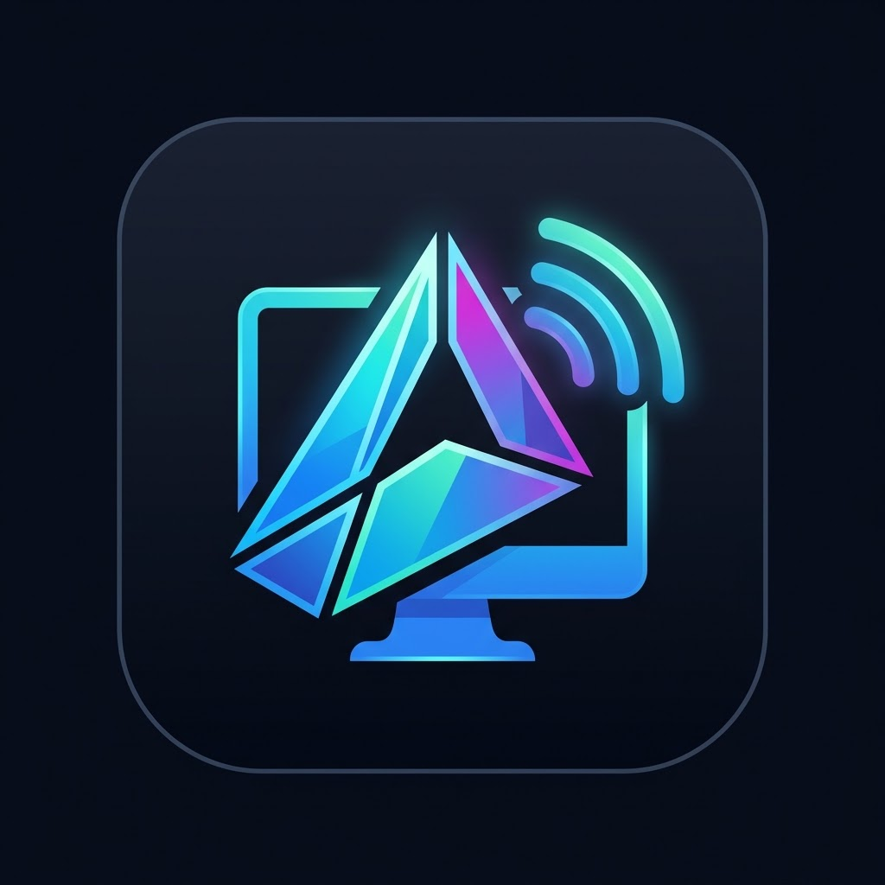

# PrysmView

<p align="center">
  
</p>

<p align="center">
  <strong>Software de Acesso Remoto Desktop de Alta Performance para PDVs (Caixas de Loja)</strong><br />
  <em>Windows 10 e Windows 11 • Latência Mínima • Criptografia Fim-a-Fim (QUIC TLS 1.3) • Custo Zero (R$ 0,00)</em>
</p>

<p align="center">
  
  
  
  
  
  
</p>

---

## 🎨 Identidade Visual Cyber Prism

O PrysmView utiliza uma linguagem visual inspirada no seu logotipo oficial prismático futurista:
- **Obsidian Dark Background:** `#0A0D16` / `#0F1422` (foco total e conforto visual para operadores).
- **Prism Neon Cyan:** `#00F0FF` (destaques primários, código de 8 dígitos e seleções ativas).
- **Electric Blue:** `#008CFF` (botões de ação e gradientes energéticos).
- **Prism Neon Violet:** `#BE2DEB` (badges do operador/técnico e prazos temporais).
- **Signal Mint Glow:** `#00FFCC` (indicador de conexão segura E2E e status online).
- **Emergency Crimson:** `#FF3355` (botão de encerramento imediato de acesso pelo caixa).

---

## 📦 Download dos Instaladores Oficiais (Distintos)

O PrysmView possui instaladores 100% separados para o cliente e para a equipe de suporte:

### 1. 🏪 PrysmView Host (Instalador para o Caixa / PDV)
- **Executável Setup:** [`dist/PrysmHost-Setup-0.1.0.exe`](dist/PrysmHost-Setup-0.1.0.exe)
- **Tamanho:** **4.82 MB** (limite NFR: < 30 MB)
- **SHA-256:** `F7D796D674243A863ABF9C8681FE4033994041AF8478A82C74CC789BC32F5F1E`
- **Conteúdo Incluso:** Serviço Windows em segundo plano (`prysmview-svc.exe`), Interface de bandeja do PDV estilo TeamViewer Host (`PrysmHost.exe`) e inicialização automática. **Não contém nenhum recurso administrativo.**

### 2. 🛠️ PrysmView Admin (Instalador para o Técnico / Suporte TI)
- **Executável Setup:** [`dist/PrysmAdmin-Setup-0.1.0.exe`](dist/PrysmAdmin-Setup-0.1.0.exe)
- **Tamanho:** **4.65 MB** (limite NFR: < 30 MB)
- **SHA-256:** `7CCA1712DECA13916175A1567CF8B1A15CBD3701F84EB5AF3F349B37F35D175D`
- **Conteúdo Incluso:** Console administrativo completo (`PrysmAdmin.exe`) com Sidebar, Dashboard, 4 KPI cards de telemetria, Conexão Rápida direta por ID, agrupamento por lojas, registros de auditoria e configurações da nuvem Azure.

---

## 🌐 Infraestrutura Cloud Ativa e Estratégia de Custos (O-06 / O-07)

- **Hospedagem Atual (Créditos Azure até 18/11/2026):** VM Ubuntu 24.04 LTS ARM64 (`Standard D2alds_v7`)
- **API de Sinalização (HTTPS):** Porta 443 TCP com proxy reverso Caddy (Let's Encrypt automático) e fallback direto interno na porta 8080 TCP
- **Relay P2P iroh (QUIC):** Porta 3340 UDP
- **Health Check de Produção:** `https://api.seudominio.com/health` (ou `http://127.0.0.1:8080/health` localmente)
- **Transição Pós-Créditos:** Modelada no [ADR 0004](docs/adr/0004-hospedagem-pos-creditos.md) para migração a custo zero para Oracle Cloud Always Free (10 TB/mês de tráfego de saída gratuito).

---

## 🏗️ Estrutura do Workspace

- `crates/core`: Protocolo, serialização compacta (`postcard`), limites de payload e regras sem I/O.
- `crates/host`: Serviço Windows (`prysmview-svc` em `LocalSystem`), captura DXGI, compressão zstd e injeção SendInput ABNT2.
- `crates/tray`: Aplicativo visual do PDV (`prysmview-tray`) estilo TeamViewer Host com travamento e código de sessão.
- `crates/viewer`: Aplicativo desktop do operador (`prysmview-viewer`) com login administrativo e canvas DXGI incremental.
- `crates/relay`: Binário e configuração do relay QUIC (`iroh-relay`).
- `crates/spikes`: Spikes de viabilidade técnica (S1: DXGI, S2: Tiles zstd, S3: iroh, S4: SendInput).
- `server/`: API de sinalização em Go com banco SQLite e autenticação de chaves Ed25519.

---

## 🚦 Execução dos Gates Determinísticos

Para garantir qualidade absoluta, nenhum código é aprovado por modelos de linguagem sem validação determinística:

### Gates Rust
```bash
cargo fmt --check
cargo clippy -- -D warnings
cargo test
```

### Gates Go (na pasta `server/`)
```bash
cd server
gofmt -l .
go vet ./...
go test ./...
```

---

## 🚀 Como Executar Localmente

### 1. Iniciar o Viewer (Operador / Técnico)
```bash
cargo run -p prysmview-viewer
```

### 2. Iniciar o Host em modo Console (PDV para testes)
```bash
cargo run -p prysmview-host --bin prysmview-svc -- --run
```

### 3. Iniciar a Bandeja do PDV (Host Interface)
```bash
cargo run -p prysmview-tray
```

### 4. Iniciar a API de Sinalização em Go
```bash
cd server
go run cmd/api/main.go
```

---

## 📚 Documentação do Projeto

- **Manual do Operador e PDV**: [docs/MANUAL-OPERADOR.md](docs/MANUAL-OPERADOR.md)
- **Atualização Assinada e Rollback**: [docs/atualizacao.md](docs/atualizacao.md)
- **Instalador Inno Setup 6**: [installer/README.md](installer/README.md)
- **Relatório de Segurança e Invasão**: [docs/testes-seguranca.md](docs/testes-seguranca.md)
- **Especificação do Protocolo**: [docs/protocolo.md](docs/protocolo.md)
- **Catálogo de Dependências**: [docs/dependencias.md](docs/dependencias.md)

---

## 📄 Licença

Este projeto é distribuído sob os termos das licenças **MIT** ou **Apache-2.0** (licença dupla), em total consonância com o arquivo `LICENSE` e a configuração do workspace em `Cargo.toml`.
